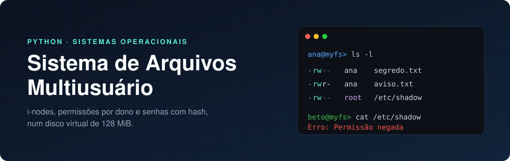
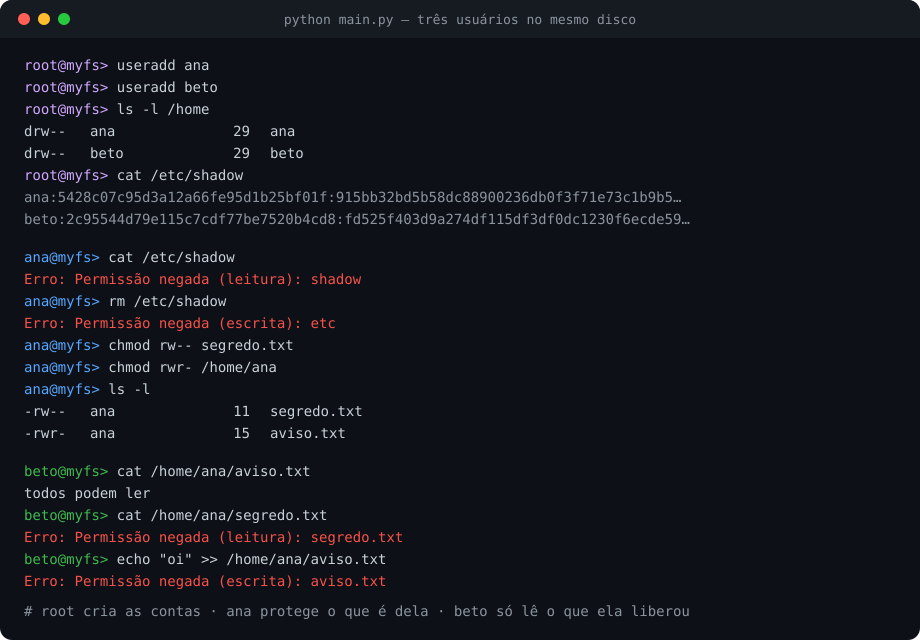
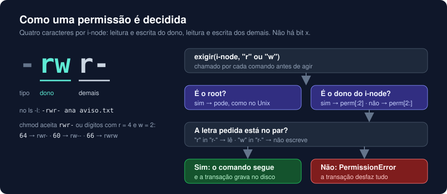
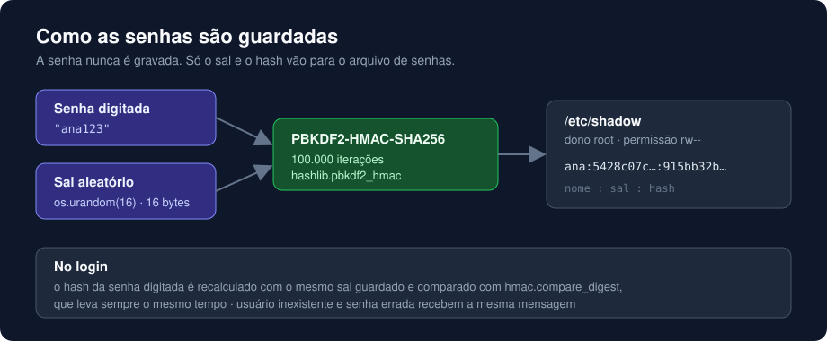
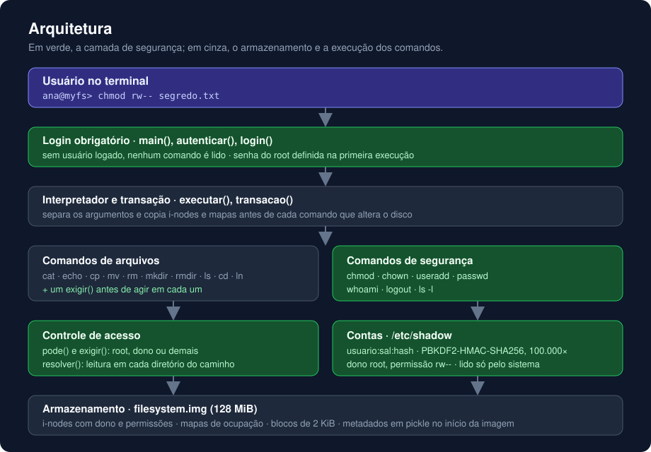
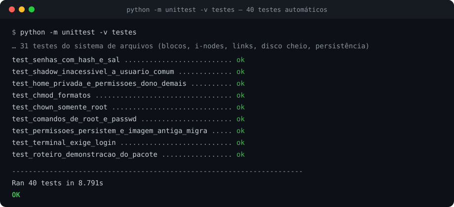

<p align="center">
  
</p>

<p align="center">
  
  
  
  
</p>

<p align="center">
  <a href="#destaques">Destaques</a> ·
  <a href="#como-o-acesso-é-decidido">Permissões</a> ·
  <a href="#como-as-senhas-são-guardadas">Senhas</a> ·
  <a href="#arquitetura">Arquitetura</a> ·
  <a href="#testes">Testes</a> ·
  <a href="#executar">Executar</a>
</p>

Um sistema de arquivos completo, escrito em Python puro, rodando dentro de um disco virtual de 128 MiB: blocos, i-nodes, diretórios, links simbólicos e persistência. Sobre essa base há uma camada de **segurança multiusuário**: cada pessoa entra com login e senha, tem sua própria pasta, e todo arquivo tem dono e permissões que o sistema realmente aplica.

<p align="center">
  
</p>

## Destaques

| Recurso | Como funciona |
|---|---|
| **Login obrigatório** | Nenhum comando é aceito antes de usuário e senha válidos. Na primeira execução, o programa pede a senha do administrador (`root`). |
| **Uma pasta por usuário** | O root cria contas com `useradd`. Cada conta ganha `/home/nome`, que só o dono acessa. |
| **Dono e permissões** | Todo arquivo pertence a quem o criou e tem dois pares de permissão: leitura e escrita do dono, leitura e escrita dos demais. |
| **`chmod` e `chown`** | O dono ou o root alteram permissões, em letras (`rwr-`) ou dígitos (`64`). Só o root troca o dono. |
| **Senhas protegidas** | Guardadas como hash PBKDF2-SHA256 com sal em `/etc/shadow`, que nenhum usuário comum lê, copia, altera ou apaga. |
| **Recusa sem efeito colateral** | Um comando barrado não altera nada no disco: o estado anterior é restaurado por uma transação. |

## Como o acesso é decidido

<p align="center">
  
</p>

Uma única função, `pode()`, decide todo acesso, e cada comando a consulta antes de agir. Para o root, sempre permite. Para o dono do arquivo, usa as duas primeiras letras da permissão; para os demais, as duas últimas.

| Operação | Exige |
|---|---|
| Ler um arquivo (`cat`, origem do `cp`) | `r` no arquivo |
| Alterar um arquivo (`echo`, destino do `cp`, `touch`) | `w` no arquivo |
| Listar ou entrar num diretório (`ls`, `cd`) | `r` no diretório |
| Atravessar um caminho (`/a/b/c`) | `r` em cada diretório do caminho |
| Criar ou remover (`touch`, `mkdir`, `rm`, `rmdir`, `ln`) | `w` no diretório pai |
| Mover ou renomear (`mv`) | `w` nos dois diretórios pais |
| `chmod` | ser o dono ou o root |
| `chown`, `useradd`, `passwd` de outro usuário | ser o root |

## Como as senhas são guardadas

<p align="center">
  
</p>

O sal vem do gerador seguro do sistema operacional, e as 100.000 iterações deixam cada tentativa de adivinhar a senha lenta. Como cada senha tem seu próprio sal, dois usuários com a mesma senha ficam com hashes completamente diferentes.

## Arquitetura

<p align="center">
  
</p>

### Decisões de projeto

**O arquivo de senhas é protegido pelo próprio sistema.** `/etc/shadow` é um arquivo comum do disco virtual, com dono root e permissão `rw--`, dentro de `/etc`, onde só o root escreve. Não há regra especial para ele. Até um link simbólico para `/etc/shadow` esbarra na permissão do alvo, porque o caminho é resolvido de novo a cada uso.

**Quem lê o shadow é o sistema, não o usuário.** As verificações estão nos comandos digitados. As funções internas de login e senha leem o arquivo diretamente, como o programa de login e o kernel fazem no Linux.

**Criar e apagar exigem escrita no diretório pai.** A entrada `nome → i-node` fica no diretório que contém o arquivo, e é ele que muda. É a regra do Unix: poder escrever num arquivo não dá direito de apagá-lo.

**Só o root troca o dono.** Se qualquer dono pudesse, um usuário conseguiria atribuir arquivos a outra pessoa.

**Sem o bit `x`.** O sistema trabalha só com leitura e escrita. Num diretório, `r` vale para listar e para atravessar.

**Toda alteração é uma transação.** I-nodes e mapas de ocupação são copiados antes de cada comando. Se uma permissão falha, a cópia é restaurada e nada é gravado. Os testes comparam o SHA-256 da imagem antes e depois de operações recusadas.

## Testes

<p align="center">
  
</p>

- **40 testes automáticos**, 8 deles dedicados à segurança: senhas, arquivo de senhas, permissões, `chmod`, `chown`, `passwd`, login e conversão de imagens antigas.
- Um roteiro de demonstração tenta, um por um, os acessos que devem ser barrados e produz **13 recusas, todas esperadas**. Um dos testes executa esse roteiro de ponta a ponta.
- Casos de limite do disco: blocos cheios, i-nodes esgotados, ciclos de links e reabertura da imagem.

## Executar

Requer Python 3.10 ou superior. Não há nada para instalar.

```bash
python main.py
```

Na primeira execução, defina a senha do `root` e faça login. A senha não aparece enquanto é digitada.

```text
root@myfs> useradd ana
root@myfs> logout
login: ana
ana@myfs> echo "meu segredo" > segredo.txt
ana@myfs> chmod rw-- segredo.txt
ana@myfs> ls -l
```

| Comando | Para quê |
|---|---|
| `python main.py < roteiro_demonstracao.txt` | Demonstração automática (numa pasta sem `filesystem.img`) |
| `python -m unittest -v testes` | Testes automáticos |

O manual completo está em [`docs/MANUAL.md`](docs/MANUAL.md), e a descrição dos testes em [`docs/VALIDACAO.md`](docs/VALIDACAO.md).

## Estrutura

```text
├── main.py                    sistema de arquivos, segurança e terminal
├── testes.py                  40 testes com imagens temporárias
├── roteiro_demonstracao.txt   sequência de comandos da demonstração
├── docs/
│   ├── MANUAL.md              todos os comandos e a organização do disco
│   └── VALIDACAO.md           testes realizados e resultados
└── assets/                    imagens deste README
```

## Números

| 128 MiB | 2.048 bytes | 8.192 | 100.000 | 40 |
|:---:|:---:|:---:|:---:|:---:|
| disco virtual | por bloco | i-nodes | iterações por senha | testes |

## Limites conhecidos

- Não há grupos de usuários nem remoção de contas.
- Não há limite de tentativas de login; cada tentativa é lenta, mas não há bloqueio.
- A proteção vale dentro do disco virtual. O arquivo `filesystem.img` no computador depende das permissões do sistema operacional, e ele guarda só os hashes das senhas.
- Os metadados usam `pickle`; abra apenas imagens de procedência conhecida.

## Tecnologias

Python 3 · hashlib · hmac · os.urandom · getpass · pickle · unittest

---

<p align="center">
  Desenvolvido por <strong>Yuri Oliveira Serra</strong> · <a href="https://github.com/yuriserra1">github.com/yuriserra1</a>
</p>
